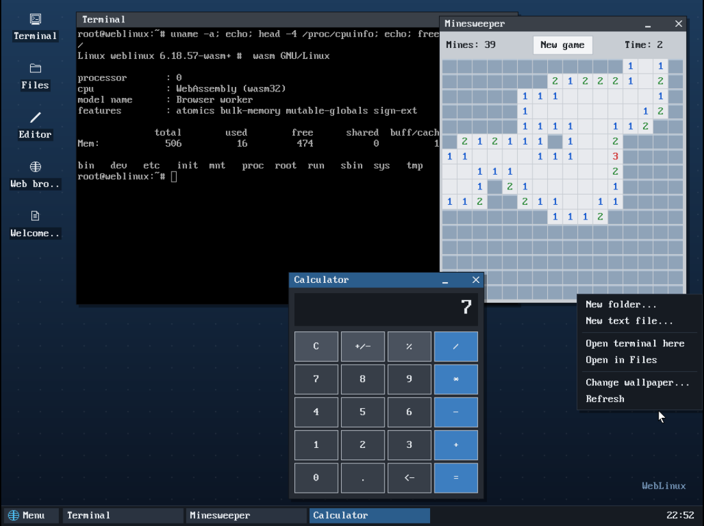

# WebLinux

Linux running natively as WebAssembly in a browser tab.

This is not an emulator. WebLinux is a port of the Linux kernel (6.18) to a new
architecture, `wasm`: the kernel is compiled to a WebAssembly module, and user programs
(musl libc, bash, BusyBox) are compiled to WebAssembly too. Every task runs in a Web
Worker on one shared memory, and the page provides the "hardware": a timer, a console,
a frame buffer, keyboard and mouse, a disk, a network card and sound.



> **Vibe coded.** The whole project, including the kernel port, the libc port, the
> build scripts and the web front end, was written by AI (Claude Code). A human set
> the goals and the rules; the code is generated. Read it with that in mind.

## Status

Working today:
- the kernel boots in the browser (no MMU, one CPU, one worker per task),
- musl libc, `fork()` and `vfork()`, signals,
- `/sbin/init`, then **bash 5.3** as a login shell with job control (`&`, `jobs`,
  Ctrl-C, Ctrl-Z, `bg`, `fg`),
- **BusyBox 1.37** for the usual Unix tools,
- a **desktop** on the frame buffer: windows, taskbar, start menu, right-click menus,
  desktop icons (`~/Desktop`), and programs: terminal, file manager (rename, delete,
  copy/cut/paste), text editor, Paint, calculator, Minesweeper, Snake, task manager,
  settings,
- **persistence**: the root file system is an overlay on an ext4 disk (with a journal,
  checked at every boot) kept in the browser's storage (OPFS), so changes survive
  closing the tab; writes reach it within a second or two,
- **networking**: an Ethernet device routed by a small NAT in the page; TCP and UDP go
  out through the page server,
- the **NetSurf** web browser (HTML, CSS, images, JavaScript),
- **sound** through Web Audio (ALSA, and OSS `/dev/dsp`).
[STATUS.md](STATUS.md) has the details and the plan.

## Run it

You need Node.js. From a checkout, run `start.bat` (Windows) or `./start.sh`, or:

```sh
node server.js 8080
```

and open <http://127.0.0.1:8080/>. The server adds the COOP/COEP headers the page needs
for `SharedArrayBuffer` and relays the guest's network connections (it can reach whatever
the machine running it can, so it only listens on localhost). Page options:
`?mode=1280x720` (screen size), `?mem=1024` (MiB), `?disk=mem` (don't persist),
`?cmdline=...`. `public/` holds the last built kernel (`vmlinux.wasm`)
and root file system (`initramfs.cpio`), so no build is needed to try it.

## Using it

- The desktop opens with a terminal (bash). The **Menu** button (or the Windows key) has
  all the programs; Help in it explains the rest. **Right-click** the desktop, icons,
  files, title bars, taskbar buttons, the terminal or the editor for a menu.
  Double-click a title bar to maximize. Ctrl+Alt+T opens a terminal, Alt+F4 closes a
  window, Alt+Tab switches.
- **Files**: F2 renames, Delete deletes, Ctrl+C/X/V copy, cut and paste files, Ctrl+H
  shows hidden files. Files in `/root/Desktop` show up as desktop icons.
- **Clipboard**: Ctrl+Shift+V pastes the host's clipboard (typed in as keys). Selecting text
  in the terminal, or Ctrl+C in the editor, copies to the host.
- The terminal scrolls back with the mouse wheel or Shift+PageUp.
- **Web browser**: NetSurf. Ctrl+U clears its address bar; its X button closes it.
- Files you change are saved in the browser's storage for this site. **Reset disk** (bottom
  bar) erases them; `poweroff` in a shell shuts down cleanly.
- **Console** (bottom bar) shows the kernel log and a second shell (`ttyW0`).

## Limits

It is a toy. One CPU, no MMU (so `fork()` works by copying memory, and programs that
need real virtual memory won't run), every exec compiles a WebAssembly module (a BusyBox
command takes ~20 ms to start), and C programs have to be cross-compiled for it: there is
no compiler inside. It needs `server.js` (or another server sending the COOP/COEP headers
and relaying the network) rather than a plain static host.

## Build it

On Ubuntu/Debian:

```sh
sh build/setup-linux.sh        # clang/lld 20, binaryen, node 24, playwright
. /opt/wltools/env
sh build/fetch-sources.sh      # Linux 6.18.57 + the wasm port, musl, bash, BusyBox
cd /wl/linux && sh /wl/build/kmake.sh wasm_defconfig && sh /wl/build/kmake.sh -j8 vmlinux.wasm
cp vmlinux.wasm /wl/public/ && cd /wl
sh build/build-libc.sh         # sysroot: kernel headers, musl, compiler-rt builtins
sh build/build-bash.sh
sh build/build-busybox.sh
sh build/build-desktop.sh
sh build/build-e2fsprogs.sh    # mke2fs/e2fsck/tune2fs for the browser disk
sh build/build-netsurf.sh      # curl, mbedTLS, image libraries, NetSurf (slow)
sh build/mkrootfs.sh           # -> public/initramfs.cpio
sh test/run-all.sh             # every boot test, in headless Chromium
```

The kernel port lives in `patches/linux/` (applied by `fetch-sources.sh` to a vanilla
tree in `linux/`), the musl port in `build/port-musl.py`.

## License

GPL-2.0 (see [LICENSE](LICENSE)). The kernel port is a modification of Linux, so the
project is under the kernel's license. Bundled third-party programs keep their own
licenses (musl: MIT, bash: GPL-3.0, BusyBox: GPL-2.0, e2fsprogs: GPL-2.0, NetSurf:
GPL-2.0, curl: curl license, mbedTLS: Apache-2.0, DejaVu fonts: free license).

Copyright dynamiteswag81.
